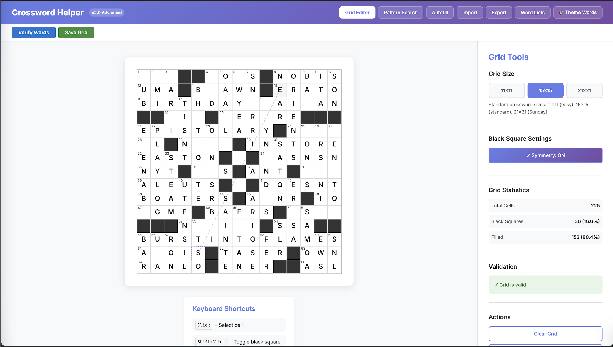
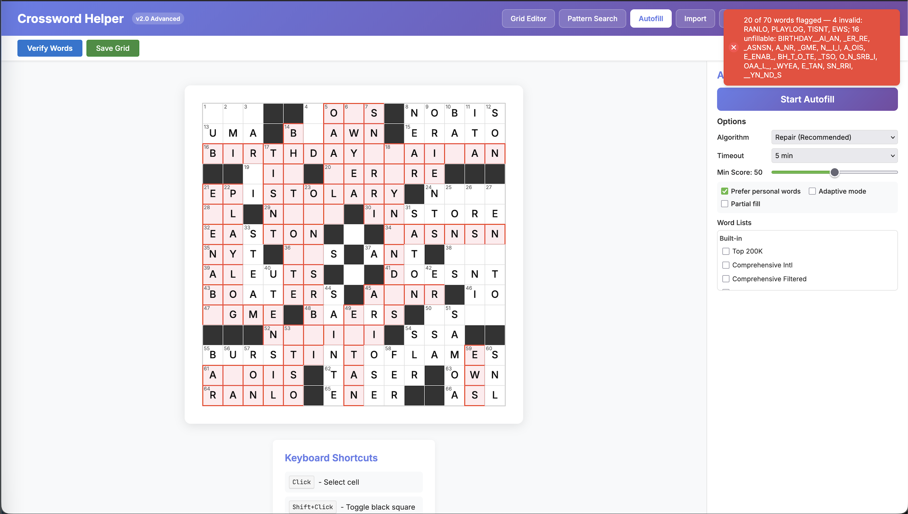
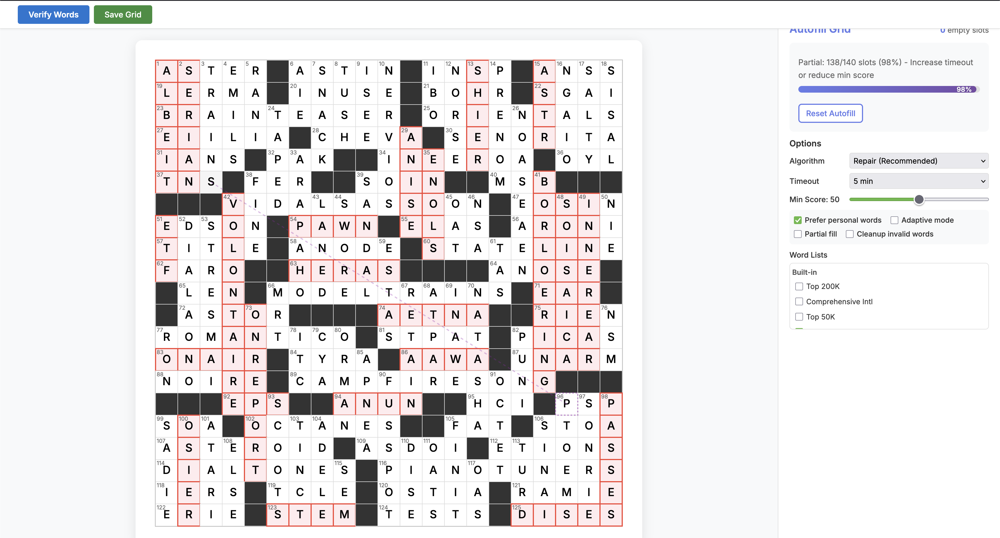

# Crossword Construction Helper

[](https://github.com/apassuello/crossword-helper/actions/workflows/test.yml)
[](https://codecov.io/gh/apassuello/crossword-helper)
[](https://www.python.org/)
[](https://opensource.org/licenses/MIT)

A toolkit for building crossword puzzles. It has a web UI for interactive grid
editing and autofill, plus a CLI for scripting and batch operations. All puzzle
logic lives in the CLI; the web app is a thin wrapper around it.

| Grid Editor | Autofill with Theme Words | 21x21 Complete Fill |
|:-:|:-:|:-:|
|  |  |  |

## Before you start

You need two tools installed first. Windows is not supported yet (macOS and Linux only).

- **Python 3.9 or later.** On macOS, install it from [python.org](https://www.python.org/downloads/).
  The `python3` that ships with macOS is a stub that opens an Xcode command-line-tools install dialog
  the first time you use it; either path works. On Linux, install your distribution's `python3` and
  `python3-venv` packages (for example `sudo apt install python3 python3-venv`).
- **Node.js 18 or later (LTS).** Install it from [nodejs.org](https://nodejs.org/), or use your
  distribution's package if it is version 18 or later.
- **The code.** Either use "Download ZIP" on the GitHub page and extract it, or run
  `git clone https://github.com/apassuello/crossword-helper.git`. After a ZIP extract, the
  `chmod +x setup.sh` line in Quick Start below is part of the steps.

## Quick Start

```bash
# One-time setup (creates venv, installs deps, builds frontend)
chmod +x setup.sh
./setup.sh

# Run the app
source venv/bin/activate
python3 run.py
# Open http://localhost:5000
```

## Using the app

New to the app? Start with the [user guide](docs/user-guide/README.md): a macOS install walkthrough, a first-crossword
tutorial, how-to guides and a reference.

Open http://localhost:5000. The tool rail on the left switches between tools:

- **Grid** -- click a square and type to enter letters; `Black square` (or Space or `.`) turns the
  selected square black, and the `Symmetry` toggle under VIEW mirrors black squares across the grid.
  Under New grid, `11×11`, `15×15` or `21×21` starts an empty grid; `Open saved` lists your saved
  grids, each with `Open` and `Delete`.
- **Lists** -- the word lists the app searches and fills from; upload your own with `Upload`.
- **Search** -- type a pattern such as `C?T` (`?` is an unknown letter), tick the word lists to
  search in, and press `Search`.
- **Theme** -- load your theme words with `Choose File`, then `Apply All Best Placements` to put
  them in the grid.
- **Autofill** -- choose an `Algorithm` and the word lists, then press `Start Autofill`.
- **Import** and **Export** -- `Import Grid` reads a saved grid from `Upload File` or `Paste JSON`;
  `Export` saves the grid as JSON, HTML or text, and `Preview` shows it first.

The top bar has `Undo`, `Redo`, `Verify words`, `Clean grid` and `Save grid`. `Save grid` asks
"Name this grid" (it suggests a name), then `Save`; the grid also saves itself as you work. `Undo` steps back one
edit at a time: a letter, a black square, a placed word, a whole `Apply All Best Placements`, a Clean or
a finished autofill. The keys are Cmd+Z (Ctrl+Z on Windows and Linux) to undo and Cmd+Shift+Z to redo.
Undo stops at a new grid, an import or an opened save.

## Features

- **Grid editor** -- interactive editing with keyboard shortcuts, symmetry
  enforcement, and auto-numbering
- **Pattern matching** -- find words matching a pattern like `C?T` (gives CAT,
  COT, CUT, etc.) using regex or trie-based search
- **Autofill** -- fill grids using CSP with backtracking, beam search, or
  iterative repair; supports theme word locking
- **Wordlists** -- ships with 44k curated words; upload your own or combine
  multiple lists
- **Export** -- HTML format

## Development Mode

For hot-reloading during frontend development, run two terminals:

```bash
# Terminal 1: Flask backend on :5000
source venv/bin/activate
python3 run.py

# Terminal 2: Vite dev server on :3000 (proxies API to Flask)
npm run dev
```

Open http://localhost:3000 -- frontend changes reload automatically.

Debug mode is off by default. To turn it on, start the backend with `FLASK_DEBUG=1`:

```bash
FLASK_DEBUG=1 python3 run.py
```

To use a port other than 5000, set the same `PORT` for both terminals. The Vite server stays on
:3000 and proxies `/api` to that `PORT`:

```bash
PORT=5001 python3 run.py   # Terminal 1
PORT=5001 npm run dev      # Terminal 2
```

## CLI Usage

The CLI is the source of truth for all puzzle logic. Activate the venv first.

```bash
# Pattern search
python -m cli.src.cli pattern "C?T" -w data/wordlists/comprehensive.txt --json-output

# Fill an example grid (11x11, 15x15, and 21x21 templates included)
python -m cli.src.cli fill data/grids/example_15x15.json \
  -w data/wordlists/comprehensive.txt \
  -t 180 --min-score 30 -o filled.json

# Validate a grid
python -m cli.src.cli validate puzzle.json

# Create a new empty grid
python -m cli.src.cli new --size 15 -o puzzle.json

# Export to HTML
python -m cli.src.cli export filled.json --format html -o puzzle.html
```

## Running Tests

```bash
# Backend + CLI tests
source venv/bin/activate
pytest

# Frontend tests
npm test

# With coverage
pytest --cov=backend --cov=cli
npm run test:coverage
```

## Project Layout

```
backend/           Flask API (routes, CLIAdapter, wordlist management)
cli/src/           CLI tool and all core algorithms (fill, pattern, grid)
src/               React frontend (components, styles)
data/wordlists/    Word lists (comprehensive.txt + specialty lists)
```

## Resources

- [The Art of Crossword Construction](docs/resources/art-of-construction.pdf) -- reference guide for puzzle construction techniques

## Known Limitations

- No multi-user or authentication support. Runs locally only.
- **Clean grid:** the toast after Clean can report more cells cleared than it actually emptied, because
  it counts locked letters that Clean keeps; the confirm's count is the right one
  ([#78](https://github.com/apassuello/crossword-helper/issues/78)). Red marks stay on words that crossed
  a removed word; run `Verify words` again to refresh them
  ([#79](https://github.com/apassuello/crossword-helper/issues/79)).
- **Autofill:** use `Repair (Recommended)`. With `Beam Search` or `Classic CSP`, a fill can stop with the
  grid unchanged and no red cell, because a letter already in the grid fits no word; Repair reworks that
  letter instead ([#75](https://github.com/apassuello/crossword-helper/issues/75)).
- **Theme:** `Apply All Best Placements` can count a word you already placed by hand in its summary
  ([#80](https://github.com/apassuello/crossword-helper/issues/80)). A JSON export keeps the letters and
  black squares but not which words are theme-locked, so after importing it the theme words can be
  overwritten; `Save grid` keeps the locks.
- **Saves with the app open in two tabs:** if the other tab changes the same save while `Verify words`,
  `Clean grid` or a theme apply is running, the result is dropped without a message; run it again
  ([#81](https://github.com/apassuello/crossword-helper/issues/81)).
- **Deleting the open grid's save, then closing the tab:** with unsaved edits the save comes back; without
  them the grid is gone after a reload. Export or save under a new name before closing
  ([#82](https://github.com/apassuello/crossword-helper/issues/82)).
- **Save toasts:** `Couldn’t save — will retry.` can appear for a grid you have already left; nothing
  retries it ([#83](https://github.com/apassuello/crossword-helper/issues/83)).
- **Restore on reload** tries only your newest save. If that one can't be read, nothing is restored;
  older saves still open from `Open saved` ([#84](https://github.com/apassuello/crossword-helper/issues/84)).

## Tech Stack

- **Backend:** Python 3.9+, Flask, Click, NumPy, pytest
- **Frontend:** React 18, Vite 5, SCSS, native `fetch`, vitest

## License

MIT — see [LICENSE](LICENSE).
