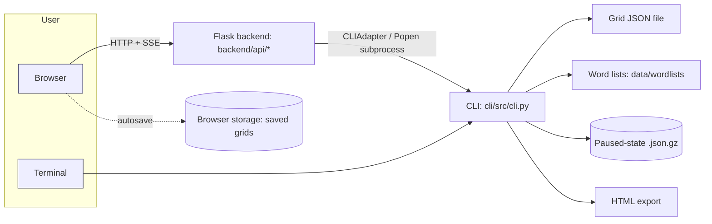

# Crossword Helper User Guide Implementation Plan

> **For agentic workers:** REQUIRED SUB-SKILL: Implement this plan task-by-task (one document per task, via `diataxis-write-doc`). Steps use checkbox (`- [ ]`) syntax for tracking.

---

**Status: APPROVED by the owner on 2026-10-29 with every default in "Decisions needed" (D1-D6) and one addition (D7: a macOS install how-to). Page writing may begin.**

Scope (ruled by the requester): documentation for people who **use** Crossword Helper to build
crosswords. Developer, contributor and architecture documentation is out of scope and is not touched.

Rules this plan inherits from `.claude/CLAUDE.md` (they shape every page below):

- No hand-written value a command can produce: no counts, timings, or "N words" in prose. Each page names
  the command that produces the number, or pastes real output.
- Backtick-cited paths and identifiers must exist in the tracked tree (`scripts/docs-check.sh` checks 3 and 4);
  dead relative links and derived counts fail the same script (checks 1 and 2).
- Cite an identifier, not a line number, for any target that has a name. `claims.md` carries both (identifier
  first, `path:line` beside it), because the requester asked for `file:line`.
- Unverified claims go in `[?]`, never asserted.

---

## Project Summary

- **Purpose:** a toolkit for constructing crossword puzzles: edit a grid, search words by pattern, place theme
  words, and autofill the rest from scored word lists.
- **Users:** (a) a crossword constructor working in the browser (primary; the README targets "a novice who
  knows nothing about this system", per the novice-readiness spec); (b) a constructor or scripter working from
  a terminal; (c) an integrator calling the HTTP API (already documented; not this guide's audience).
- **Core workflow:** new grid (11, 15 or 21 square) -> black squares (optionally symmetric) -> type or place
  letters / theme words -> check words -> autofill -> keep or discard the result -> save -> export.
- **Platform:** macOS and Linux; Windows unsupported (README, `setup.sh`).

## System Architecture Summary

Three layers, one direction of authority: React UI -> Flask backend -> CLI subprocess -> algorithms. The CLI
is the source of truth; the backend never re-implements crossword logic (`docs/ARCHITECTURE.md` section 1).
For a user this means: **every capability exists in the CLI; the web UI exposes a subset with a friendlier
surface**, and the HTTP API mirrors the backend routes. Two facts matter to documentation:

1. Pause/resume is reachable from the CLI (`fill --task-id`, `pause`, `list-states`, `resume`) and the HTTP
   API, but the web UI has **no pause control** (`AutofillPanel.jsx` header comment says the pause UI was
   dropped; `pauseFill` in `src/api/client.js` is defined but a grep of `src/` finds no caller, so no pause
   control is rendered).
2. Several UI features are deliberately hidden (Clues, Heatmap, "Suggest Black Square"; `ToolRail.jsx` and
   `AutofillPanel.jsx` header comments; export PDF/`.puz`). The guide must not document them as available.



User interaction flow: browser tools (Grid, Search, Autofill, Theme, Lists, Import, Export) call API routes;
terminal users run `python -m cli.src.cli <command>`. Saved grids from the web UI live in the browser's own
storage (`src/lib/storage.js`), not in the repo's `data/grids/`; the CLI reads and writes grid JSON files.

### User-facing entry points (derived from code, not from docs)

| Surface | Entry point | Where it is defined | Reader-facing? |
|---|---|---|---|
| Setup | `./setup.sh` | `setup.sh` | Yes (README covers it) |
| Run web app | `python3 run.py` (`PORT`, `FLASK_DEBUG` env) | `run.py` | Yes |
| CLI | `python -m cli.src.cli <command>`; also `cli/crossword` (must run with `cli/` as cwd) | `cli/src/cli.py`, `cli/crossword` | Yes |
| CLI commands | `new`, `validate`, `fill`, `show`, `export`, `pattern`, `normalize`, `number`, `analyze`, `build-cache`, `pause`, `resume`, `list-states`, `parse-wordlist`, `import-nyt` | one `@cli.command` each in `cli/src/cli.py`; list reproducible with `python -m cli.src.cli --help` | Yes |
| Web UI tools | Grid, Search, Autofill, Theme, Lists, Import, Export | `TOOLS` in `src/components/bench/ToolRail.jsx` | Yes |
| Web UI top bar | Undo, Redo, Verify words, Clean grid, Save grid, light/dark toggle, backend status | `TopBar.jsx` | Yes |
| Web UI keys | arrows, letters, Space/`.` (black), Enter, Tab, Backspace/Delete; Cmd/Ctrl+Z, Cmd+Shift+Z / Ctrl+Y | `CrosswordGrid.jsx` key dispatch, `App.jsx` undo listener | Yes |
| HTTP API | seven blueprints under `backend/api/` (`routes`, `grid_routes`, `theme_routes`, `pause_resume_routes`, `wordlist_routes`, `progress_routes`, `constraint_routes`) | `@<bp>.route` decorators | Integrators; already documented in `docs/api/` |
| Helper script | `python scripts/print_grid.py <grid.json> [--compact\|--detailed]` | `scripts/print_grid.py` | Marginal; one line in the CLI how-to at most |
| Not user-facing | `scripts/demo_phase5.py`, `scripts/fetch_crossword_datasets.sh`, `scripts/normalize_wordlists.py`, `scripts/filter_gibberish.py`, `scripts/analyze_crossword_datasets.py`, `scripts/validate_hybrid_system.sh` | `scripts/` | No (maintainer data tooling); not documented here |

Drift already visible from the code: `docs/ARCHITECTURE.md` states a CLI command count that no longer matches
`python -m cli.src.cli --help` (the count is stated in its Changelog). This guide states no such count.

## Toolchain Detection

- **Docs format:** plain Markdown under `docs/`; no site generator (no MkDocs/Sphinx config found). Navigation
  is `docs/README.md`.
- **Repo docs conventions:** living docs use HADS blocks (`[SPEC]`/`[NOTE]`/`[?]`). See "Decisions needed" D2.
- **Doc checks available:** `scripts/docs-check.sh` (links, derived counts, cited paths/identifiers),
  `scripts/check-guards.sh`, the vendored `review-docs` skill with `scripts/check-doc-links.py`.
- **Test/dev workflow:** `pytest` (default suite, slow deselected), `npx vitest run`, `npm run build`,
  pre-commit (black, isort, ruff, flake8, guards, commit-msg check). Never `--no-verify`.
- **What can be run in this sandbox:** the CLI runs now (click and numpy are present; the repo ships
  `data/wordlists/comprehensive.txt` and example grids). The backend needs Flask (not installed here); the
  frontend needs `npm install` and `npm run build` (neither run yet). I propose installing both into a venv
  and `node_modules` that stay outside version control (both are gitignored), then driving the web UI with
  the preinstalled Chromium/Playwright to capture real behaviour for the tutorial. If the proxy blocks the
  installs (PyPI is reachable; npm is untested), UI claims fall back to `unverified` in `claims.md` and the CLI path is still fully verified.

## Existing Documentation

Catalogue (non-archive; `docs/archive/` ignored as instructed). Classification uses `DIATAXIS.md`.

```text
File: README.md
Purpose: Install prerequisites, quick start, tour of the web tools, features, CLI examples, known limitations
Classification: Mixed (how-to quick start + reference tour + explanation-lite + known issues)

File: docs/README.md
Purpose: Navigation index of repo documentation
Classification: Reference (navigation); developer-oriented, no user-guide entry

File: docs/ARCHITECTURE.md
Purpose: How the three layers fit; why CLI-is-truth; pause/resume mechanism
Classification: Explanation (developer audience)

File: docs/ALGORITHM_DEEP_DIVE.md
Purpose: Grid model, scoring, matcher and autofill algorithm internals
Classification: Explanation (developer audience)

File: docs/specs/CLI_SPEC.md
Purpose: Per-command usage, flags, grid / theme-entries / wordlist formats, pause-resume workflow
Classification: Reference (strong; its own header says its tables came from --help, which cannot show Click defaults; see the defaults rule below)

File: docs/api/API_REFERENCE.md
Purpose: HTTP API reference with example workflows
Classification: Reference (+ small how-to section "Example Workflows")

File: docs/api/openapi.yaml
Purpose: Machine-readable endpoint spec, documented source of truth for routes
Classification: Reference

File: cli/README.md
Purpose: CLI invocation and pointers
Classification: Reference stub (HADS)

File: data/wordlists/README.md
Purpose: Provenance, filtering and scoring of the shipped list; recommended fill settings
Classification: Mixed (explanation + reference)

File: CONTRIBUTING.md, docs/dev/DEVELOPMENT.md, docs/ops/TESTING.md
Purpose: Contributor setup, conventions, tests
Classification: How-to / reference for developers (out of scope)

File: docs/dev/FABRICATION-LOG.md
Purpose: Record of claims found false against code
Classification: Explanation / audit record (out of scope; read as a warning about trust)

File: docs/dev/qa/2026-10-22-fresh-install-run.md, docs/dev/qa/2026-10-26-novice-readiness-run.md
Purpose: Manual acceptance-run evidence for a novice install and workflow
Classification: Reference (test evidence). Valuable provenance for UI behaviour; not user-facing.

File: docs/superpowers/specs/*.md, docs/superpowers/plans/*.md
Purpose: Design specs and implementation plans for in-flight capability work
Classification: Explanation / plan (developer audience; spec 0.2.x is the origin of many UI behaviours)

File: docs/resources/SOURCES.md, docs/resources/research/**, docs/resources/art-of-construction.pdf
Purpose: Research index, reports, and a construction reference PDF
Classification: Reference / external material
```

Structural problems found:

- **No user guide exists.** The only user-facing prose is README.md, which mixes install, tour, features,
  CLI examples and a long known-limitations list in one page. A newcomer has no end-to-end first-crossword
  path and no per-task guide.
- **Duplicated content:** CLI flags live in `CLI_SPEC.md`, `cli/README.md` and README examples; web-tool
  descriptions live in README "Using the app" and "Features". The two README lists overlap and disagree
  slightly (Features says export is "HTML format"; the Export panel offers JSON, HTML and Text; the CLI
  `export --format` accepts only `html`).
- **Navigation:** `docs/README.md` "Where to Start" has no entry for someone who wants to *use* the tool
  (entries are architecture, dev setup, API, CLI spec, tests, contribute).
- **Trust:** `FABRICATION-LOG.md` records that docs and source comments carried false claims. Existing prose
  is therefore treated as a lead, never as proof (see the claims ledger).
- **Learning path:** unclear. README Quick Start ends at "Open http://localhost:5000"; the tool tour that
  follows lists controls but no task sequence.
- **Hidden-feature drift risk:** README correctly omits hidden tools, but `openapi.yaml` documents a route
  whose UI is hidden (`/grid/suggest-black-square`; `API_REFERENCE.md` does not mention it). A user-guide
  page must not promise it.

## Documentation Architecture

### Documentation vision

Help a person who wants to **build a crossword** (not develop the software) go from a fresh checkout to a
saved, exported puzzle, then find the right how-to or option table whenever they get stuck. After reading
they should be able to start the app, set up a grid, bring in words and theme entries, run and judge an
autofill, and save or export, from the browser or the terminal.

### Top-level navigation (user-guide scope only)

```text
Section: User Guide (home)
Purpose: Orient the reader, link to install (README), tutorial, how-tos, reference
Contains: one landing page
Excludes: install steps (single home: README.md), feature marketing

Section: Tutorials
Purpose: Learn by doing: one complete first crossword
Contains: one tutorial in the web app
Excludes: option catalogues, alternatives

Section: How-to Guides
Purpose: Accomplish a specific task
Contains: grid setup, saving, word search, own word lists, theme words, autofill, check/clean, import/export, CLI fill, pause/resume, troubleshooting
Excludes: teaching from zero, option tables

Section: Reference
Purpose: Look up exact commands, controls, defaults, file formats
Contains: CLI, web app, file formats
Excludes: instructions, rationale

Section: Explanation (optional)
Purpose: Understand why autofill behaves as it does
Contains: at most one page, only if approved
Excludes: algorithm internals (stay in ALGORITHM_DEEP_DIVE.md)

Not in scope: Architecture, Contributing, API (all exist; linked, not rewritten)
```

### Learning architecture

- First page a new user reads: `docs/user-guide/README.md`, which sends a first-time reader to
  `how-to/install-on-macos.md` (D7). `README.md` keeps its short prerequisites and Quick Start and gains one
  "User guide" link.
- First successful outcome: a small (11x11) grid with a few hand-placed words, autofilled or partially filled,
  saved and exported to HTML.
- Core tutorial: `tutorials/first-crossword.md` only. Install is **not** repeated in it: the tutorial links to
  the install how-to, which is the single detailed home for installation (the README keeps only its short
  summary; the how-to is checked against `setup.sh`, so the two cannot silently diverge).
- Redirects out of the tutorial: each step that offers a choice links to the matching how-to or reference row
  rather than explaining alternatives inline.

### Task architecture

```text
Task group: Get it running
User goal: Install the app and all its dependencies from the GitHub repo and open it
Likely documents: install-on-macos
Related reference: cli (invocation), web-app
Related explanation: none

Task group: Build the grid
User goal: Get a valid empty grid, shape it, keep my work
Likely documents: set-up-the-grid, save-open-and-recover
Related reference: web-app, file-formats
Related explanation: none

Task group: Bring in words
User goal: Find words, use my own lists, place theme entries
Likely documents: find-words-by-pattern, use-your-own-word-lists, add-theme-words
Related reference: web-app, cli, file-formats
Related explanation: none

Task group: Fill and check
User goal: Fill the rest, judge it, remove bad entries
Likely documents: autofill-a-grid, check-and-clean-a-grid, fill-from-the-command-line, pause-and-resume-a-fill
Related reference: cli, web-app
Related explanation: how-autofill-chooses-words (optional)

Task group: Move work in and out
User goal: Import a grid, export for printing or reimport
Likely documents: import-and-export-grids
Related reference: file-formats, cli

Task group: When something goes wrong
User goal: Diagnose an error or odd result
Likely documents: troubleshoot
Related reference: cli (exit codes), web-app
```

### Conceptual architecture

Needed concepts, kept minimal and placed inside the pages that use them rather than in a separate
explanation section: slot (an across/down entry of 3 or more letters), word score and `min score`, locked
cells (typed letters, theme-locked letters, and "autofilled" letters), and the difference between the
Repair / Hybrid / Beam / Classic CSP algorithms. The only candidate for a standalone page is the last one
(optional E1). Everything else a user needs is stated once where first used and linked from there.

### Reference architecture

Mirrors the public interface: CLI (commands, arguments, options, defaults, exit codes), web app (tools,
controls, option defaults, keys), file formats (grid JSON, theme-entries JSON, wordlist lines, paused-state
file, HTML export). The HTTP API reference already exists and is linked, not rewritten.

### Contributor and developer architecture

Out of scope by instruction. Existing pages stay untouched.

### Structural issues to resolve

1. Add a user-guide entry to `README.md` and `docs/README.md` (small edits, no rewrites).
2. Avoid duplicating `docs/specs/CLI_SPEC.md`: the user-guide CLI reference is organised by user task, lists
   the options a user needs with defaults taken from the `default=` arguments in `cli/src/cli.py` (see the defaults rule below), and links CLI_SPEC for exhaustive detail and
   the pause/resume IPC internals. Where the two disagree, the code wins and the disagreement is recorded in
   `claims.md` (not silently fixed in CLI_SPEC; that is a separate change).
3. README "Known Limitations" stays the single home for open-issue notes; guide pages link to it instead of
   copying, and the claims ledger re-checks that each linked limitation still matches the issue state it cites.

## Documentation Plan

### Hierarchy

```text
Home
  - docs/user-guide/README.md                       (new landing page)
Getting Started
  - Install Crossword Helper on macOS (how-to)                  -- new (D7)
  - (existing) README.md  "Before you start" + "Quick Start"   -- unchanged, linked
Tutorials
  - Your first crossword (web app, 11x11)
How-to Guides
  - Build the grid
    - Set up the grid
    - Save, reopen and recover your work
  - Bring in words
    - Find words by pattern
    - Use your own word lists
    - Add theme words
  - Fill and check
    - Autofill a grid
    - Check and clean a grid
    - Fill a grid from the command line
    - Pause and resume a fill (command line)
  - Move work in and out
    - Import and export grids
  - Troubleshoot
Reference
  - Command-line reference
  - Web app reference
  - File formats
Explanation (optional)
  - How autofill chooses words
Existing, linked only
  - docs/api/API_REFERENCE.md, docs/specs/CLI_SPEC.md, docs/ARCHITECTURE.md, README.md "Known Limitations"
```

### Document entries

```text
Title: User Guide
Path: Home
File: docs/user-guide/README.md
Diátaxis classification: navigation hub (not one of the four types; contains links and one-line descriptions only)
Purpose: Tell a reader which page to open for their situation.
Contents:
  - Who this guide is for; web app vs command line in two sentences
  - "Start here": the macOS install how-to, then the tutorial
  - Tables of how-tos by goal, reference pages, and the existing API / CLI-spec links
Depends on:
  - how-to/install-on-macos.md
Related documents:
  - tutorials/first-crossword.md
Priority: Required
Status: New
```

```text
Title: Your first crossword
Path: Tutorials
File: docs/user-guide/tutorials/first-crossword.md
Diátaxis classification: tutorial (written via the tutorial-engineer agent, then routed through diataxis-write-doc)
Purpose: Take a newcomer from a running app to a saved, exported 11x11 puzzle with one guaranteed result.
Contents:
  - Start the app (link to the install how-to; check "online" status dot)
  - New 11x11 grid; place black squares with Symmetry on; read the Total/Black/Filled/Words stats
  - Type a few letters; use Search for a pattern; check with Verify words
  - Run Autofill with the recommended algorithm; keep the result
  - Save grid; export HTML and open it
  - Where to go next (links into how-tos and reference)
Depends on:
  - how-to/install-on-macos.md
Related documents:
  - how-to/set-up-the-grid.md, how-to/autofill-a-grid.md, reference/web-app.md
Priority: Required
Status: New
Verification plan: every step is run in the real web UI (Playwright) and the observed outcome pasted; if the
  frontend cannot be built here, the tutorial is cut down to what is verified and the gap is reported.
```

```text
Title: Install Crossword Helper on macOS
Path: Getting Started
File: docs/user-guide/how-to/install-on-macos.md
Diátaxis classification: how-to
Purpose: Take a Mac with nothing installed to the app open in the browser, from the GitHub repository.
Contents:
  - Prerequisites: Python 3.9+ and Node.js 18+ (versions and the check commands as `setup.sh` enforces them);
    macOS and Linux only, Windows unsupported
  - Get the code: `git clone` or "Download ZIP" (and the `chmod +x setup.sh` that a ZIP extract needs)
  - Run `./setup.sh`: what it creates (`venv/`, `node_modules/`, `frontend/dist/`) and its "Missing:" messages
  - Start the app: activate the venv, `python3 run.py`, open http://localhost:5000; `PORT=<other>` when 5000 is taken
  - Check it works: status dot reads online; `python -m cli.src.cli --version`
  - Update later (pull, re-run `./setup.sh`) only if the script is shown to support it
Depends on: none
Related documents: tutorials/first-crossword.md, how-to/troubleshoot.md, README.md (short summary of the same steps)
Priority: Required
Status: New
Verification plan: `setup.sh` and `run.py` are run in this sandbox (Linux) in a fresh checkout, with real
  output pasted; every step and message is tied to `setup.sh`/`run.py`. This sandbox is **not** macOS, so
  the macOS-specific statements (the Xcode command-line-tools stub behind the system `python3`, AirPlay
  Receiver holding port 5000, the `python.org` installer path) cannot be run here. They are cited to their
  code comment or README line and to the recorded macOS acceptance run in
  `docs/dev/qa/2026-10-26-novice-readiness-run.md`, and are marked `unverified` in `claims.md` and `[?]` in
  the page unless a code line proves them.
```

```text
Title: Set up the grid
Path: How-to Guides > Build the grid
File: docs/user-guide/how-to/set-up-the-grid.md
Diátaxis classification: how-to
Purpose: Start a new grid of the right size, shape the black squares, and confirm it is valid.
Contents:
  - New grid: 11x11 / 15x15 / 21x21 (confirm-before-replace)
  - Black square button, Space or `.`, symmetry toggle (VIEW > Symmetry)
  - Reading the GRID stats and the VIOLATIONS list
  - Same task on the command line: `new`, `validate`, `number`, `show`
Depends on: tutorials/first-crossword.md
Related documents: reference/web-app.md, reference/cli.md, reference/file-formats.md
Priority: Required
Status: New
```

```text
Title: Save, reopen and recover your work
Path: How-to Guides > Build the grid
File: docs/user-guide/how-to/save-open-and-recover.md
Diátaxis classification: how-to
Purpose: Keep a grid, get it back after a reload, and step back from a mistake.
Contents:
  - Save grid (name prompt), autosave behaviour, Open saved, Delete (asks first)
  - Undo / Redo: buttons and keys; what undo does not cross (new grid, import, open)
  - What reload restores, and the limits (link README "Known Limitations")
Depends on: set-up-the-grid.md
Related documents: import-and-export-grids.md
Priority: Required
Status: New
```

```text
Title: Find words by pattern
Path: How-to Guides > Bring in words
File: docs/user-guide/how-to/find-words-by-pattern.md
Diátaxis classification: how-to
Purpose: List words that fit a pattern such as C?T from one or more word lists.
Contents:
  - Search tool: pattern, lists, algorithm, sort, min score
  - Command line: `pattern` with `-w`, `--max-results`, `-a`, `--json-output`
  - Pattern rules (what `?` means; case; length) -- as verified in code
Depends on: tutorials/first-crossword.md
Related documents: use-your-own-word-lists.md, reference/cli.md
Priority: Required
Status: New
```

```text
Title: Use your own word lists
Path: How-to Guides > Bring in words
File: docs/user-guide/how-to/use-your-own-word-lists.md
Diátaxis classification: how-to
Purpose: Add a custom list, check how the app reads it, and choose lists for search and autofill.
Contents:
  - Lists tool: upload with a name, preview, confirm; add words; delete
  - Line formats (`WORD`, `WORD;50`, `word,50`), accent folding, what is rejected
  - Dry-run a file with `parse-wordlist`; speed up loading with `build-cache`
  - Choosing a priority theme list in Autofill
Depends on: find-words-by-pattern.md
Related documents: reference/file-formats.md
Priority: Required
Status: New
```

```text
Title: Add theme words
Path: How-to Guides > Bring in words
File: docs/user-guide/how-to/add-theme-words.md
Diátaxis classification: how-to
Purpose: Load theme entries, place them in the grid, and keep autofill from overwriting them.
Contents:
  - Theme panel: choose file, loaded words, placement suggestions, Apply All Best Placements
  - Locked cells; how theme locks differ from typed letters
  - What the JSON export does and does not keep (link README limitation)
  - Command line: `--theme-entries` file and `--theme-wordlist`
Depends on: set-up-the-grid.md
Related documents: autofill-a-grid.md, reference/file-formats.md
Priority: Required
Status: New
```

```text
Title: Autofill a grid
Path: How-to Guides > Fill and check
File: docs/user-guide/how-to/autofill-a-grid.md
Diátaxis classification: how-to
Purpose: Run autofill from the browser, read the outcome, and keep or discard it.
Contents:
  - Start Autofill: algorithm, timeout, min score, adaptive mode, partial fill, cleanup, word lists
  - Progress, Cancel, and the result: Keep fill / Keep partial fill / Reset
  - Typed letters are never changed; red cells mean a typed letter blocks the fill
  - Known limits (link README "Known Limitations")
Depends on: tutorials/first-crossword.md
Related documents: fill-from-the-command-line.md, how-autofill-chooses-words.md (optional), reference/web-app.md
Priority: Required
Status: New
```

```text
Title: Check and clean a grid
Path: How-to Guides > Fill and check
File: docs/user-guide/how-to/check-and-clean-a-grid.md
Diátaxis classification: how-to
Purpose: Find entries that are not in your word lists and remove them without losing good letters.
Contents:
  - Verify words: red marks, what counts as valid
  - Clean grid: the confirm shows how many letters go; theme-locked cells stay
  - Command line `validate` for structure (symmetry, connectivity)
Depends on: autofill-a-grid.md
Related documents: reference/web-app.md
Priority: Recommended
Status: New
```

```text
Title: Fill a grid from the command line
Path: How-to Guides > Fill and check
File: docs/user-guide/how-to/fill-from-the-command-line.md
Diátaxis classification: how-to
Purpose: Autofill a grid file in a terminal and save the result.
Contents:
  - `fill` with `-w`, `-t`, `--min-score`, `-a`, `-o`; defaults from the `default=` arguments (defaults rule below)
  - Locked letters (`--lock-filled`, the `locked` key), theme entries, adaptive, partial, cleanup
  - Reading the output; `show` / `export` afterwards; exit codes
Depends on: set-up-the-grid.md
Related documents: pause-and-resume-a-fill.md, reference/cli.md
Priority: Recommended
Status: New
Verification plan: run on `data/grids/example_11x11.json` with `comprehensive.txt` and paste real output.
```

```text
Title: Pause and resume a fill (command line)
Path: How-to Guides > Fill and check
File: docs/user-guide/how-to/pause-and-resume-a-fill.md
Diátaxis classification: how-to
Purpose: Stop a long fill, inspect the saved state, and continue it.
Contents:
  - Start `fill --task-id`; `pause TASK_ID`; `list-states`; `resume TASK_ID`
  - Matching `--state-dir` and `--pause-flag-dir`; where state is stored by default
  - Not available in the web UI (confirmed by call-site check) -- stated plainly
Depends on: fill-from-the-command-line.md
Related documents: reference/cli.md
Priority: Recommended
Status: New
Verification plan: attempt a real pause on a slow-enough fill; if no fill is slow enough to pause in this
  sandbox, mark the flow `unverified` rather than describe it.
```

```text
Title: Import and export grids
Path: How-to Guides > Move work in and out
File: docs/user-guide/how-to/import-and-export-grids.md
Diátaxis classification: how-to
Purpose: Bring a grid in from a file or pasted JSON, and export it for printing or later reimport.
Contents:
  - Import tool: Upload File and Paste JSON; Preview and Import
  - Export tool: JSON (reimport), HTML (printable), Text; Preview first
  - Command line: `export --format html`, `show`, `import-nyt` (NYT JSON format)
Depends on: set-up-the-grid.md
Related documents: reference/file-formats.md
Priority: Required
Status: New
```

```text
Title: Troubleshoot common problems
Path: How-to Guides > Troubleshoot
File: docs/user-guide/how-to/troubleshoot.md
Diátaxis classification: how-to
Purpose: Map a symptom to the cause and fix for the failures a user can actually hit.
Contents:
  - `setup.sh` "Missing:" lines; port in use; backend "offline" status dot
  - CLI errors and hints (non-standard size, missing wordlist, `-w` required)
  - Autofill stops, red cells, empty result
Depends on: tutorials/first-crossword.md
Related documents: README.md "Known Limitations", reference/cli.md
Priority: Recommended
Status: New
Source rule: every symptom row is taken from a message string found in code (`setup.sh`, `run.py`,
  `cli/src/cli.py`, the panels) and reproduced where it can be, never from memory.
```

```text
Title: Command-line reference
Path: Reference
File: docs/user-guide/reference/cli.md
Diátaxis classification: reference
Purpose: State every command, argument, option, default and exit code, neutrally.
Contents:
  - Invocation (`python -m cli.src.cli`, `cli/crossword`, `--version`, `--help`)
  - One section per command with an options table; defaults generated from the `default=` arguments
  - Exit codes and error shape (`--json-output` error object)
Depends on: none
Related documents: docs/specs/CLI_SPEC.md (exhaustive spec), how-to pages
Priority: Required
Status: New
Verification plan: each options table is generated by the defaults command in the process commitments, not typed and not copied from `--help` or CLI_SPEC.
```

```text
Title: Web app reference
Path: Reference
File: docs/user-guide/reference/web-app.md
Diátaxis classification: reference
Purpose: List every visible control, option default, and key binding in the web app.
Contents:
  - Top bar; tool rail; VIEW toggle; GRID stats; VIOLATIONS
  - Per-tool controls and defaults (Autofill options and defaults; Search; Lists; Theme; Import; Export)
  - Keyboard map
  - Hidden / unavailable features (named, so readers stop looking for them)
Depends on: none
Related documents: reference/cli.md, tutorials/first-crossword.md
Priority: Required
Status: New
```

```text
Title: File formats
Path: Reference
File: docs/user-guide/reference/file-formats.md
Diátaxis classification: reference
Purpose: Specify the files a user creates or supplies.
Contents:
  - Grid JSON (`size`, `grid` with `.` and `#`, optional `locked`)
  - Theme-entries JSON (`"(row,col,direction)": "WORD"`); theme word file used by the Theme panel
  - Word list lines and shipped lists (listing produced by a command, not typed)
  - Paused-state file; HTML export
Depends on: none
Related documents: how-to pages that produce these files
Priority: Required
Status: New
```

```text
Title: How autofill chooses words
Path: Explanation
File: docs/user-guide/explanation/how-autofill-chooses-words.md
Diátaxis classification: explanation
Purpose: Explain word scores, min score and the four algorithms well enough to choose settings.
Contents:
  - What a score is and what min score removes
  - Repair vs Hybrid vs Beam vs Classic CSP, in user terms
  - Why a fill can stop short; what locked letters do
Depends on: autofill-a-grid.md
Related documents: docs/ALGORITHM_DEEP_DIVE.md (internals), README "Known Limitations"
Priority: Optional
Status: New
Note: written only if approved (D3). It is the page with the most unverifiable-by-reading claims.
```

```text
Title: README.md  (small edit)
Path: Home
File: README.md
Diátaxis classification: unchanged (mixed)
Purpose: Add one "User guide" link beside "Using the app"; no other change.
Contents:
  - A single link line to docs/user-guide/README.md
Priority: Required
Status: Existing
Transformation:
  Type: Rewrite (one added line)
  Source: README.md
  Target: README.md
  Reason: Requester asked that the guide be linked from the README; avoiding a README restructure keeps one home per fact.
```

```text
Title: docs/README.md  (small edit)
Path: Home
File: docs/README.md
Diátaxis classification: reference (navigation)
Purpose: Add a "Use the app" entry to "Where to Start" and the tree.
Priority: Required
Status: Existing
Transformation:
  Type: Rewrite (two added lines)
  Source: docs/README.md
  Target: docs/README.md
  Reason: The index lists every other audience; without this line the guide is undiscoverable from the repo's documented navigation page.
```

### Verification and process commitments (apply to every page)

- `docs/diataxis/claims.md` columns: `ID | Page | Claim | Proof (identifier + path:line) | Status (verified / unverified / false) | Evidence`.
  A claim with no proving line is cut or tagged `[?]` in the page. Where a command is safe to run here, the
  real output is pasted into the page and referenced from the ledger.
- **Defaults rule (CLI).** `--help` cannot prove a default: no option asks Click to show its default, so the real defaults
  (for example `fill` timeout, min score, algorithm) are not printed, and the defaults that are printed are
  hand-typed `help=` prose, the class of text `docs/dev/FABRICATION-LOG.md` found false. The proof for a default
  is the `default=` keyword in `cli/src/cli.py`, produced by this command (an option with no default prints
  `Sentinel.UNSET`, which the tables render as "none"):
  `python3 -c "import click; from cli.src.cli import cli; [print(n, p.opts, repr(p.default)) for n,c in cli.commands.items() for p in c.params if isinstance(p, click.Option)]"`
  Where a `help=` string and the `default=` disagree, the claims row is `false` and it is reported under D4.
- **Defaults rule (web app).** The Autofill panel's defaults come from `DEFAULT_OPTIONS` in `AutofillPanel.jsx`,
  not from the CLI. Each gets its own claims row and proof; the two sets are never assumed equal.
- Pages that depend on the web UI are verified with a headless browser run; nothing about UI behaviour is
  taken from README or QA notes alone.
- After writing: `review-docs` over `docs/user-guide/` (including `scripts/check-doc-links.py`),
  `scripts/docs-check.sh`, then re-probe every claim a review finding touched.
- One conventional commit per logical step on a `docs(user-guide):` branch. No AI attribution trailers (as
  requested). Branch: see D6.

### Decisions needed from you

| # | Question | Default if you say nothing |
|---|---|---|
| D1 | Approve the page set above, and which **Recommended / Optional** pages to cut? | Write Required + Recommended; skip the Optional explanation. |
| D2 | `.claude/CLAUDE.md` says living docs under `docs/` use HADS blocks. User-guide pages are for people, and tutorials do not fit `[SPEC]` blocks. OK to write them as plain Diátaxis pages, using inline `[?]` for unverified claims? | Plain pages with inline `[?]`. |
| D3 | Include the optional explanation page? | No. |
| D4 | The ARCHITECTURE command-count drift and any CLI_SPEC/code disagreements found while writing: record in `claims.md` only, or also fix those docs in this branch? | Record only; fix in a separate commit on request. |
| D5 | OK to install Flask etc. into a venv and `node_modules` outside version control, to drive the real UI? PyPI is reachable here (Flask wheels downloaded); npm is untested. | Yes (nothing installed is committed). |
| D6 | Branch: this session is bound to `chore/vendor-doc-skills` and may not push elsewhere without your say-so. Commit the guide there, or do you want a new `docs/user-guide` branch (cut from this one)? | Commit on `chore/vendor-doc-skills`. | Note: the draft-plan commit already went to that branch while D6 was open, and the branch's CI is already red because `docs-check.sh` fails on `.claude/licenses/README.md` (the licenses table names an identifier the guard cannot find). I can fix that as a separate first commit, whichever branch you pick.
| D7 | Add a macOS install how-to (requested 2026-10-29; the first draft sent readers to the README). | Added above, Required. |
