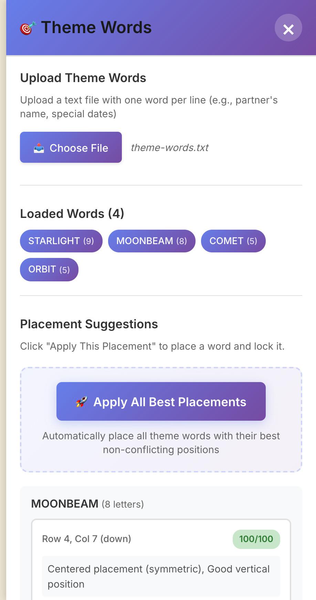
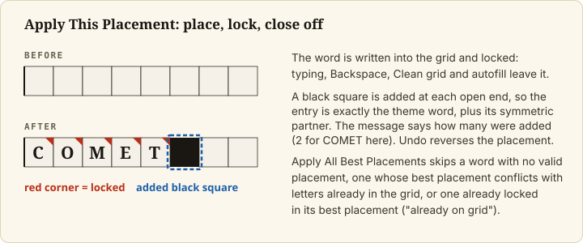
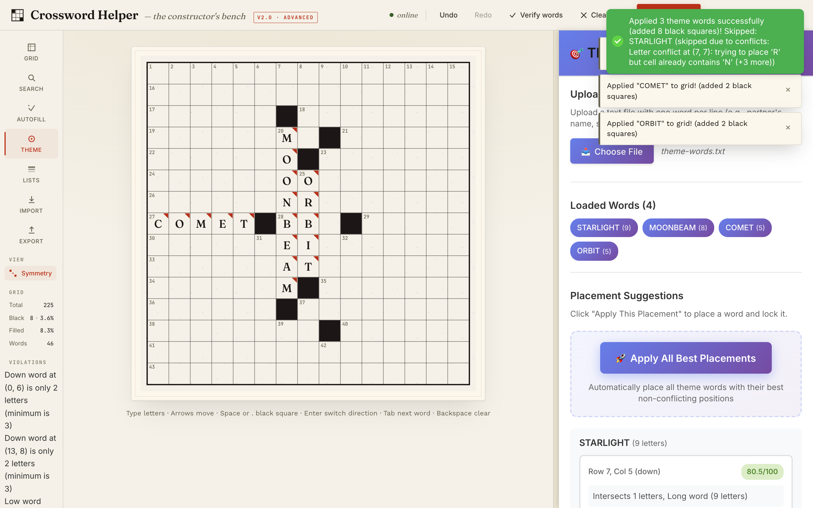

# Add theme words

## Goal

Load your theme words, place them in the grid, and lock them so autofill keeps them. Use this when your puzzle
has set entries (a theme, names, a date) that must survive the fill.

## Prerequisites

- The app is running and a grid is open, with the black squares you want
  ([Set up the grid](set-up-the-grid.md)). The panel reads the current grid size, so choose the size first.
- A plain text file with one theme word per line.

## Steps

### 1. Prepare the theme file

One word per line, letters only (the full rules are in [File formats](../reference/file-formats.md#theme-word-file)).
A line that contains a space, hyphen or digit is dropped without a message, so write `ICECREAM`, not
`ICE CREAM`. A list of more than 50 words (the limit `MAX_THEME_WORDS` in `backend/core/theme_placer.py`), a
word shorter than 3 letters or a word longer than the grid is wide is an error, and any one error rejects the
whole list: fix the file and load it again.

### 2. Load the words

Open the **Theme** tool in the left rail. In `Upload Theme Words`, click `Choose File` and pick your file.

The app validates the list. If something is wrong, it shows an error toast starting `Invalid theme words:` and
lists each problem. If the list is valid, it reports `Loaded N theme words` and immediately works out where
each word could go. The words appear under `Loaded Words`.

### 3. Place the words

The `Placement Suggestions` section lists each word with its candidate positions. Each suggestion shows
`Row r, Col c (direction)` (counted from 1, like the labels on the grid), a score out of 100 and a short reason.
Hovering over a suggestion does not change the grid. Click `✓ Apply This Placement` to place and lock that word.

*The Theme panel after loading four words into an empty 15×15 grid.*

To place everything at once, click `Apply All Best Placements`. It applies each word's best suggestion in
turn and skips a word that has no valid placement, whose best placement conflicts with something already in
the grid, or that is already locked in its best placement (`already on grid`); the skipped words are listed with
the reason.

Placing a word can add black squares to the grid, so the `Black` count may rise; the message after a placement
says how many it added. `Undo` reverses a placement.

*After Apply All Best Placements: three words placed and locked (red corners), eight black squares added, and STARLIGHT skipped because its R would land on MOONBEAM's N.*

### 4. Know what a lock does

A placed theme word is theme-locked: its squares show a small coloured corner, you cannot overwrite them by
typing or clear them with `Backspace`, you cannot make one of them black, `Clean grid` leaves them alone, and
autofill treats them as fixed.

You can also lock a letter you typed yourself: right-click the square, or select it and press `Cmd+L` (`Ctrl+L`
on Linux). The same action unlocks it.

If you change the grid so a suggestion no longer fits, the suggestions are refreshed for the changed grid.

## Final Result

The theme words are in the grid, marked as locked, and they are still there after an autofill.

## Known problems

- A JSON export keeps letters and black squares but not which words are theme-locked, so after importing it the
  theme words can be overwritten. `Save grid` keeps the locks.

It is tracked under "Known Limitations" in the [README](../../../README.md).

## Next Steps

- Fill around the theme: [Autofill a grid](autofill-a-grid.md).
- The theme word file: [File formats](../reference/file-formats.md).
