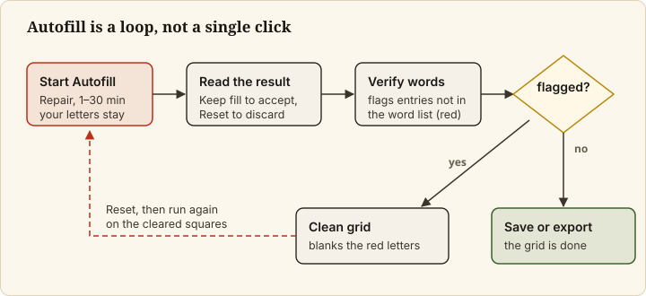
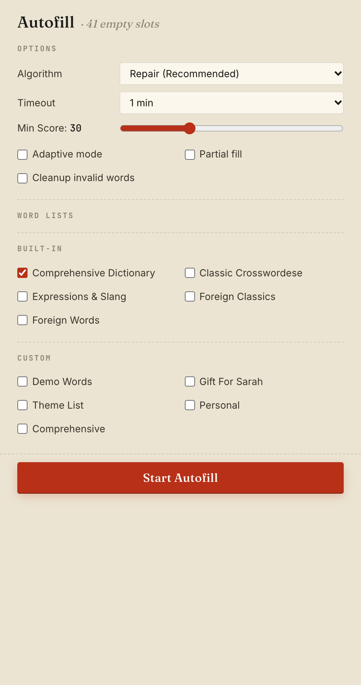
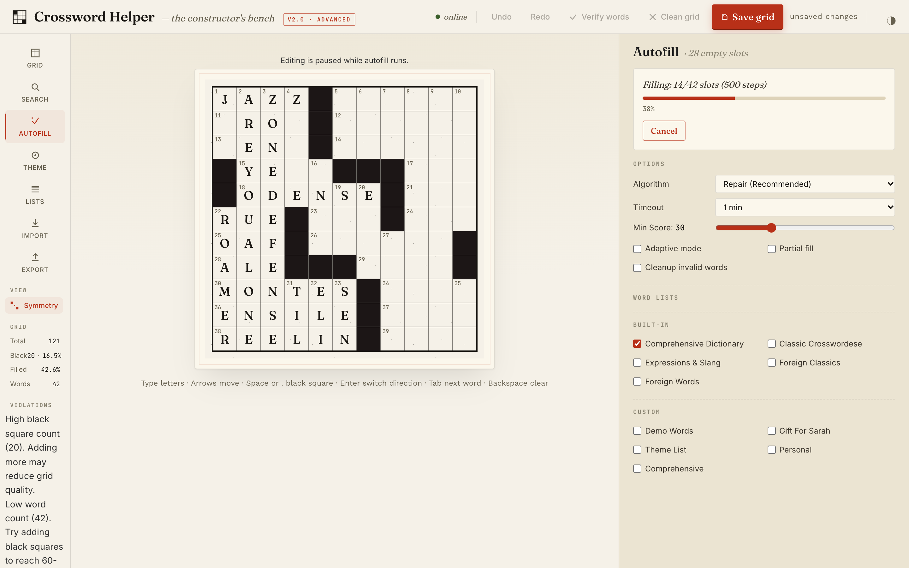
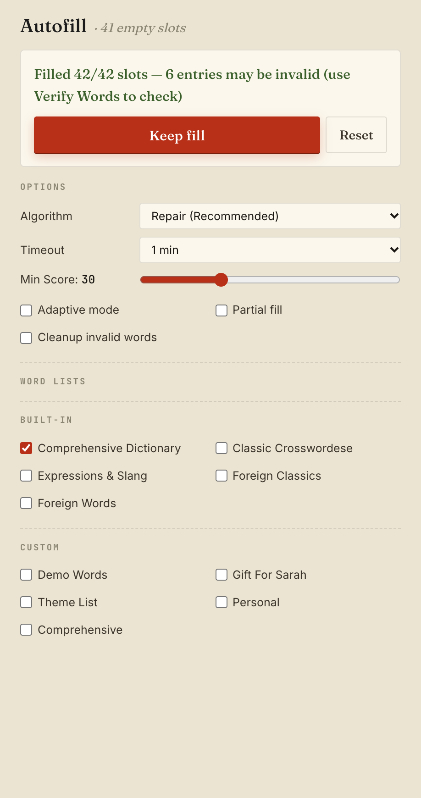

# Autofill a grid

## Goal

Let the app fill the empty squares of your grid with words from your word lists, then keep or discard the
result. Autofill is known to be imperfect: it can finish with entries that are not valid words, and some
settings can stop without changing the grid. This page shows how to run it and read what comes back.

## Prerequisites

- A grid with black squares set and any words you want to keep already typed or placed
  ([Set up the grid](set-up-the-grid.md), [Add theme words](add-theme-words.md)).
- At least one word list ticked (`Comprehensive Dictionary` is ticked by default).

## Steps

### 1. Open Autofill and review the options

Click **Autofill** in the left rail. The heading shows how many slots are still empty (a slot is one across or
down entry; a slot with some letters but not all of them still counts as empty). Leave the options on their
defaults unless you have a reason to change them:

*The Autofill panel, here with Timeout set to 1 min. The lists under Custom are the ones on the computer this was captured on.*

| Option | What it does | Default |
|---|---|---|
| `Algorithm` | `Repair (Recommended)`, `Hybrid (Beam + Repair)`, `Beam Search`, `Classic CSP` | `Repair (Recommended)` |
| `Timeout` | How long a run may take: 1, 2, 5, 10 or 30 min | 5 min |
| `Min Score` | Minimum word score the fill may use, 0 to 100 in steps of 10 | 30 |
| `Adaptive mode` | [?] Lets the fill add black squares when it gets stuck; a `Max adaptations` slider (1 to 5) appears | off, 3 |
| `Partial fill` | [?] Stops when stuck instead of backtracking hard | off |
| `Cleanup invalid words` | [?] After the fill, removes invalid words while keeping letters shared with valid crossing words | off |
| Word Lists | Which lists the fill may take words from; under **Custom**, a ticked list can be made the `Priority theme list` | `Comprehensive Dictionary` |

Use `Repair (Recommended)`. The README warns that with `Beam Search` or `Classic CSP` a run can stop with the
grid unchanged and no red cell (see [Known Limitations](../../../README.md#known-limitations)).

[?] *The descriptions of `Adaptive mode`, `Partial fill` and `Cleanup invalid words` come from the command-line
tool's help text; their effects were not measured for this page.*

Raising `Min Score` limits the fill to higher-scoring words but makes a complete fill harder; at the top of
the scale a run on an open grid fills almost nothing.

### 2. Start the run

Click `Start Autofill`. The button is greyed out, with a hint under it, when no word list is ticked
(`Select at least one word list`) or when there is nothing left to fill (`Clear some cells to run autofill
again`). It is only shown while no result is open: after any outcome, click `Reset` before you start another
run.

While it runs, the grid shows `Editing is paused while autofill runs.`, and the panel shows a progress bar
and `Cancel`. Wait for it to end, or click `Cancel`.

### 3. Read the result

The panel ends with one of these outcomes:

| Message | What happened | What you can do |
|---|---|---|
| `Successfully filled N/M slots!` | The fill completed with valid words; it is already in the grid | Click `Reset`, then carry on |
| `Filled N/M slots — K entries may be invalid (use Verify Words to check)` (or `some entries may need review` in place of the count) | Every square is filled, but some entries are not in the word list | `Keep fill`, or `Reset` |
| `Partial: N/M slots (P%)` | The run ended with squares still empty | `Keep partial fill (N/M slots)`, or `Reset` |
| `Autofill could not fill around the highlighted letters.` | Letters already in the grid left no valid fill; those squares are marked red | `Keep partial fill`, or `Reset`, then change the red letters |
| `No word fits the highlighted letters.` or `The selected word lists have no words of length N.` | The run could not start usefully: a pattern fits no word in the chosen lists | Change the highlighted letters or tick another list |
| `Cancelled by user` | You clicked `Cancel` | `Reset`; a `Keep partial fill` offer may appear if the run had made progress [?] |
| `No solution found` | The run found no fill | `Reset` [?] |
| `Autofill failed`, or the message the backend gave | The run failed | `Reset` [?] |
| `Lost contact with the autofill run.` | The app lost its connection to the run | `Reset`, then run again [?] |
| `Autofill was paused outside the app.` | Someone paused the run from the command line; the app has no pause control | `Keep partial fill` if offered, or `Reset` [?] |

[?] *Rows marked `[?]` are read from the app's code (`src/hooks/useAutofillMachine.js`) and were not reproduced
for this page.*

For the outcomes with a `Keep` button, the grid keeps showing the state from before the run until you click
`Keep fill` (or `Keep partial fill`). `Reset` closes the result without taking the fill.

*A filled-but-unverified outcome. The grid behind it still shows the pre-run state until you click Keep fill.*

Autofill does not change letters you typed or theme words you locked.

### 4. Check what you kept

Click `Verify words` in the top bar. Entries that are not in the word list are flagged and listed in a
message; see [Check and clean a grid](check-and-clean-a-grid.md). `Verify words` checks only the shipped
`Comprehensive Dictionary`, so words that come only from a custom list you ticked are flagged too, and `Clean
grid` would blank them. To run again, click `Reset`, clear some squares if the grid is full, and click
`Start Autofill`; results differ from run to run.

## Final Result

The grid is filled (or partly filled) with your choice of result kept, and `Verify words` tells you which
entries to look at again.

## Next Steps

- Remove or fix invalid entries: [Check and clean a grid](check-and-clean-a-grid.md).
- Every autofill control and its default: [Web app reference](../reference/web-app.md).
