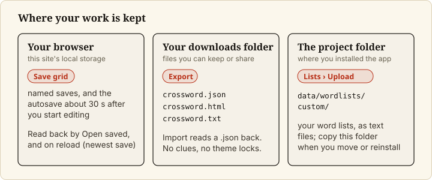
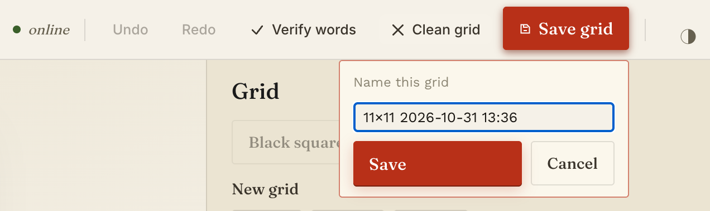
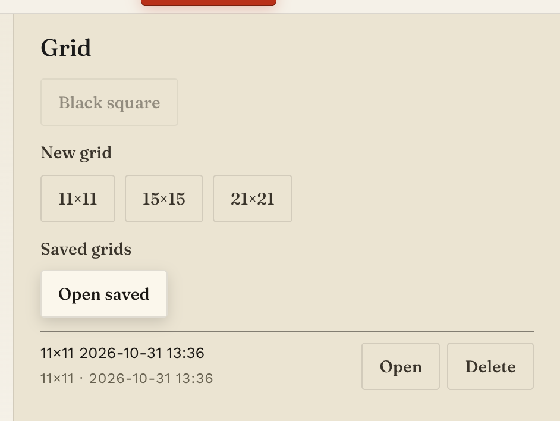
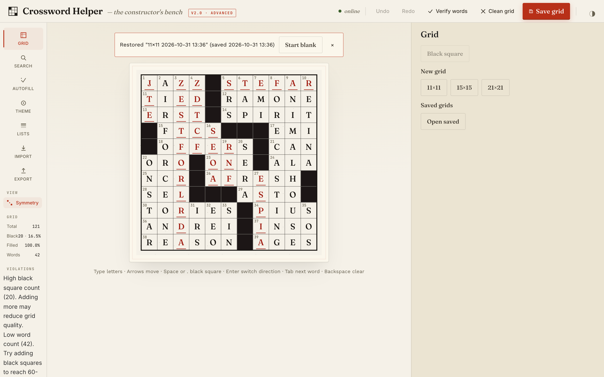

# Save, reopen and recover your work

## Goal

Keep a grid so you can come back to it, get it back after closing or reloading the tab, and step back from a
mistake. These steps apply to the web app.

## Prerequisites

- The app is running and you have a grid open ([Set up the grid](set-up-the-grid.md)).

## Steps

### 1. Save the grid under a name

Click `Save grid` in the top bar. A prompt titled `Name this grid` appears with a suggested name (for example
`11×11 2026-10-29 13:53`). Edit the name if you like and click `Save` (or press `Cancel`, or `Escape`, to
close the prompt without saving).

If another saved grid already has that name, the app asks `Replace the saved grid named "<name>"?`. Click
`Replace` to overwrite it, or `Cancel` and choose a different name.

After a save, the label beside the button reads `saved locally · just now`, then ages (for example
`saved locally · 1m ago`).

The app also saves your grid by itself, about 30 seconds after you start editing (the delay is `AUTOSAVE_MS`
in `src/hooks/useSaveMachine.js`). While changes are waiting the label reads `unsaved changes`, then `saving…`,
then `saved locally · just now`; if a save fails it reads `offline — will retry`. A named save is how you keep
a version you want to find again.

Saved grids are stored in your browser's local storage. They are not files in the project folder. [?] *Browser
storage is per browser, so they should not appear in another browser or on another computer, and clearing the
site's data removes them; this is general browser behaviour and was not tested here.* To keep a copy outside
the browser, [export the grid](import-and-export-grids.md).

### 2. Reopen a saved grid

In the **Grid** tool, under **Saved grids**, click `Open saved`. Each saved grid is listed with its size and
save time, and `Open` and `Delete` buttons. Click `Open` on the one you want. If the current grid has
content, the app asks `Replace the current grid? Unsaved changes are lost.` first.

### 3. Delete a saved grid

In the same list, click `Delete`. The app asks `Delete "<name>"?`; click `Delete` to confirm.

### 4. Recover after a reload

When you reload the page, the app reopens your most recent save and shows a banner: `Restored "<name>" (saved
<time>)`, with `Start blank` and a dismiss `×`. `Start blank` only dismisses the banner and opens the Grid tool;
it does not clear the grid. To get an empty grid, click `11×11`, `15×15` or `21×21` under `New grid` and confirm
with `Replace`.

*After a reload: the banner above the grid names the save it restored.*

Only the newest save is restored automatically. Older saves are still in `Open saved`.

### 5. Step back from a mistake

Click `Undo` in the top bar, or press `Cmd+Z` (`Ctrl+Z` on Linux); `Redo` is `Cmd+Shift+Z`. [?] *The README
describes undo as one step per letter, with a placed word, `Apply All Best Placements`, a clean or a finished
autofill each undoing as one step, and as not reaching back across starting a new grid, importing or opening a
saved grid; this was not re-tested for this page.*

## Final Result

The label by `Save grid` reads `saved locally · just now`, and the grid appears under `Open saved`.

## Known problems

If the browser's storage is full, a save fails with `Could not save: browser storage is full. Delete a saved
grid or export this one.` Other save and restore edge cases are listed under "Known Limitations" in the
[README](../../../README.md).

## Next Steps

- Export a copy you can print or re-import: [Import and export grids](import-and-export-grids.md).
- All controls: [Web app reference](../reference/web-app.md).
