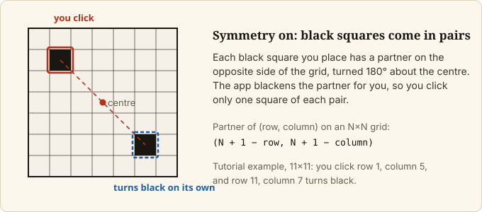
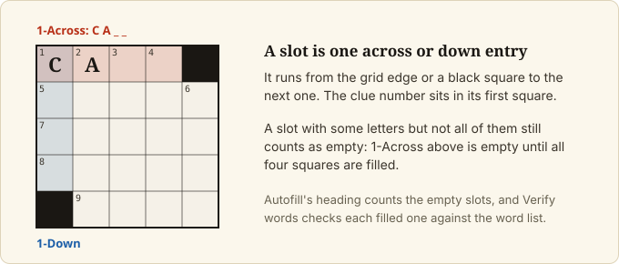

# Set up the grid

## Goal

Start a new grid of the size you want, shape its black squares, and check the pattern against the app's
warnings.

## Prerequisites

- The app is running ([Install on macOS](install-on-macos.md)).

## Steps

### 1. Start a new grid

Open the **Grid** tool in the left rail. Under **New grid**, click `11×11`, `15×15` or `21×21`.

If the current grid has any content, the app first asks `Replace the current grid? Unsaved changes are lost.`
Click `Replace` to continue or `Cancel` to keep your work. The app opens with an empty 15×15 grid.

### 2. Turn squares black

Click a square, then press `Space` or `.`. Press the same key again to turn it white. The `Black square`
button in the Grid tool does the same for the selected square, and is greyed out when no square is selected
or the square cannot be changed (a theme-locked square cannot be made black). Turning a square black erases any
letter in it and, with Symmetry on, in its mirror square too; `Undo` brings the letters back.

### 3. Keep the pattern symmetric

Under **VIEW** in the left rail, the `Symmetry` toggle is on by default. While it is on, turning a square
black also turns black the square directly opposite it through the centre of the grid, so you only click
one square of each pair. Click `Symmetry` to turn mirroring off.

### 4. Read the numbers, stats and advice

Clue numbers appear in the squares where words start and update as you edit.

The **GRID** block in the left
rail shows `Total`, `Black` (count and percentage of the grid), `Filled` and `Words`. Below it, a
**VIOLATIONS** block lists messages about the pattern. Some are advice, such as a high black-square count or a
low word count; others are warnings about the grid itself, such as isolated white regions or a word under three
letters (positions in these messages count from 0). None of them stops you from editing, filling or exporting.

### 5. Move around with the keyboard

The hint under the grid lists the keys: type letters, arrow keys move, `Space` or `.` toggles a black square,
`Enter` switches between across and down, `Tab` jumps to the next word, `Backspace` clears. `Undo` and `Redo`
are in the top bar, on `Cmd+Z` and `Cmd+Shift+Z` (`Ctrl+Z` and `Ctrl+Shift+Z` on Linux).

## Final Result

The **GRID** block reports your black-square count, and the numbers appear in the squares.

## Next Steps

- Put words in: [Find words by pattern](find-words-by-pattern.md), [Add theme words](add-theme-words.md),
  [Autofill a grid](autofill-a-grid.md).
- Keep your work: [Save, reopen and recover your work](save-open-and-recover.md).
- Every control and key: [Web app reference](../reference/web-app.md).
