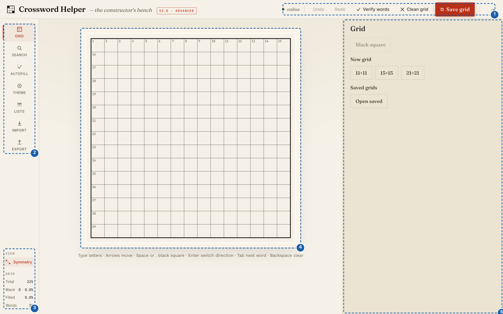

# Web app reference

What each control in the web app is called, what it does, and its default. For instructions, see the
[how-to guides](../README.md#how-to-guides). Labels are written as they appear on screen.

*(1) Top bar, (2) and (3) Left rail: the tools, then VIEW, GRID and VIOLATIONS, (4) the grid (Keyboard and mouse), (5) the panel of each tool, described in the sections below.*

## Top bar

| Control | What it does |
|---|---|
| Status label | `online` when the backend is healthy, `degraded` when the backend reports itself unhealthy, `offline` when it cannot be reached |
| `Undo`, `Redo` | Step back and forward through your edits. Disabled when there is nothing to undo or redo, while autofill runs, or while `Apply All Best Placements` runs |
| `Verify words` | Checks every slot against the shipped `Comprehensive Dictionary` list only (not your own lists) and flags entries that are not in it. Disabled when `offline` or while autofill runs |
| `Clean grid` | Clears the squares `Verify words` marks red, except theme-locked ones, after asking `Clean will remove N letters`. Disabled when `offline` or while autofill runs |
| `Save grid` | Opens the `Name this grid` prompt (`Save`, `Cancel`) and saves the grid in the browser |
| Saved label | `unsaved changes`, `saving…`, then `saved locally · just now` and later `saved locally · Nm ago`; `offline — will retry` if a save fails. Autosave runs about 30 seconds after you start editing |
| Theme button (`◐` / `◑`) | Switches between light and dark appearance; the choice is remembered |

## Left rail

| Control | What it does |
|---|---|
| Tools: `Grid`, `Search`, `Autofill`, `Theme`, `Lists`, `Import`, `Export` | Switch the right-hand panel |
| VIEW > `Symmetry` | On by default. While on, turning a square black also turns black its 180° opposite |
| GRID block | `Total` squares, `Black` (count and percentage), `Filled` (percentage), `Words` |
| VIOLATIONS | Messages about the pattern: advice (a high black-square count, a low word count) and warnings about the grid itself (isolated white regions, a word under three letters, with positions counted from 0). Shown only when there are any; tagged `(unverified)` while a check is pending. Never blocks anything |

## Grid tool

| Control | What it does |
|---|---|
| `Black square` | Toggles the selected square between black and white. Turning a square black erases its letter, and with Symmetry on the mirror square's letter too (`Undo` restores them). Disabled with no selection or when the square cannot be changed (theme-locked) |
| `New grid`: `11×11`, `15×15`, `21×21` | Starts an empty grid of that size. Asks `Replace the current grid? Unsaved changes are lost.` (`Replace`) if the grid has content |
| `Saved grids` > `Open saved` | Lists your saved grids, each with size, save time, `Open` and `Delete` (`Delete "<name>"?` asks first) |

The app opens with an empty 15×15 grid.

## Search tool

| Control | Default | Notes |
|---|---|---|
| Pattern field | empty | Placeholder `Enter pattern (e.g., ?I?A)`; at least 3 characters; `?` is an unknown letter; lowercase is accepted |
| `Search in wordlists:` | `Comprehensive Dictionary` ticked | At least one must be ticked or `Search` is disabled |
| `Algorithm` | `Regex (Classic)` | Or `Trie (Fast)` |
| `Sort by` | `Score` | Or `Alphabetical`, `Length`; applied when you click `Search` |
| `Min Score` | 0 | Filters the results; applied when you click `Search` |
| Results | | `Results (N)`; each shows word, score, source (the list's file name) and length. A search returns at most 50 words. Clicking a result writes it into the grid from the selected square in the selected direction |

## Autofill tool

| Option | Default | Choices |
|---|---|---|
| `Algorithm` | `Repair (Recommended)` | `Repair (Recommended)`, `Hybrid (Beam + Repair)`, `Beam Search`, `Classic CSP` |
| `Timeout` | 5 min | 1 min, 2 min, 5 min, 10 min, 30 min |
| `Min Score` | 30 | Slider from 0 to 100 in steps of 10 |
| `Adaptive mode` | off | Adds a `Max adaptations` slider (1 to 5, default 3) |
| `Partial fill` | off | |
| `Cleanup invalid words` | off | |
| Word Lists | `Comprehensive Dictionary` ticked | **Built-in** lists, and **Custom** lists, each of which can be made the `Priority theme list` when ticked |

Buttons: `Start Autofill` (disabled with no list ticked or nothing to fill; shown only while no result is open, so
click `Reset` after a result), `Cancel` (during a run), `Keep fill`, `Keep partial fill (N/M slots)`, `Reset`
(after a run). The heading shows the number of empty slots (slots with some letters but not all still count as
empty) and of theme words. The outcome messages are tabulated in [Autofill a grid](../how-to/autofill-a-grid.md).

## Theme tool

| Control | What it does |
|---|---|
| `Choose File` | Loads a text file of theme words (one per line, under 1 MB) |
| `Loaded Words` | The words that passed validation, with their lengths |
| `Analyze Placements` | Works out candidate positions (this also runs automatically after a successful load) |
| `Placement Suggestions` > `✓ Apply This Placement` | Places and locks one suggestion. Each suggestion shows `Row r, Col c (direction)` (from 1), a score out of 100 and a reason; hovering changes nothing on the grid |
| `Apply All Best Placements` | Places every word's best non-conflicting suggestion and lists the words it skipped. Placing can add black squares |
| `×` | Closes the panel |

## Lists tool

| Control | What it does |
|---|---|
| `Upload Wordlist` (`Cancel Upload`) | Opens the upload form: `Wordlist Name:`, `Select File:`, `Upload` (shows a `Preview`), then `Confirm` or `Cancel` |
| `Categories`, list names | Browse the shipped and custom lists |
| `Show Stats`, `Add Words`, delete | For a custom list: statistics; `Add Words` opens a box (`Enter words (one per line)`) that you submit with `Add Words to List`; delete asks with a browser dialog (`Delete wordlist "custom/<name>"? This cannot be undone.`). Shipped lists are read-only |

## Import tool

| Control | What it does |
|---|---|
| `Upload File` | Choose a `.json` file |
| `Paste JSON` | `Paste JSON Data` field and `Validate JSON` |
| `Preview` | Statistics for the grid about to be imported |
| `Import Grid`, `Clear` | Import it (after the replace confirm, if the grid has content) or discard the preview |

## Export tool

| Control | What it does |
|---|---|
| `Export Format` | `JSON (for reimport)`, `HTML (printable)`, `Text (simple)` |
| `Preview` | Shows the text or JSON in the panel (not available for HTML) |
| `Export` | Downloads `crossword.json`, `crossword.html` or `crossword.txt` |

## Keyboard and mouse

| Input | Action |
|---|---|
| Click a square | Select it |
| Letter keys | Write the letter and move on in the selected direction (not on black or theme-locked squares) |
| Arrow keys | Move; up and down select the down direction, left and right the across direction |
| `Space` or `.` | Toggle black (not on a theme-locked square) |
| `Enter` | Switch between across and down |
| `Tab`, `Shift+Tab` | Next, previous word start |
| `Backspace`, `Delete` | Clear the letter; `Backspace` on an empty square steps back (nothing happens on a theme-locked square) |
| Right-click a square, or `Cmd+L` / `Ctrl+L` on the selected square | Toggle its theme lock |
| `Shift`-click or `Alt`-click a square | Toggle black without selecting it |
| Click the already-selected square | Switch between across and down |
| `Cmd+Z` / `Ctrl+Z` | Undo |
| `Cmd+Shift+Z` / `Ctrl+Shift+Z`, `Ctrl+Y` | Redo |

## Not in the app

These are not shown in the interface, so you will not find them: a Clues tool, a Heatmap view toggle, a
`Suggest Black Square` button, PDF and `.puz` export, and an `Include clues` option. There is no pause button
for autofill; use `Cancel`, which stops the run (a `Keep partial fill` offer may follow).
